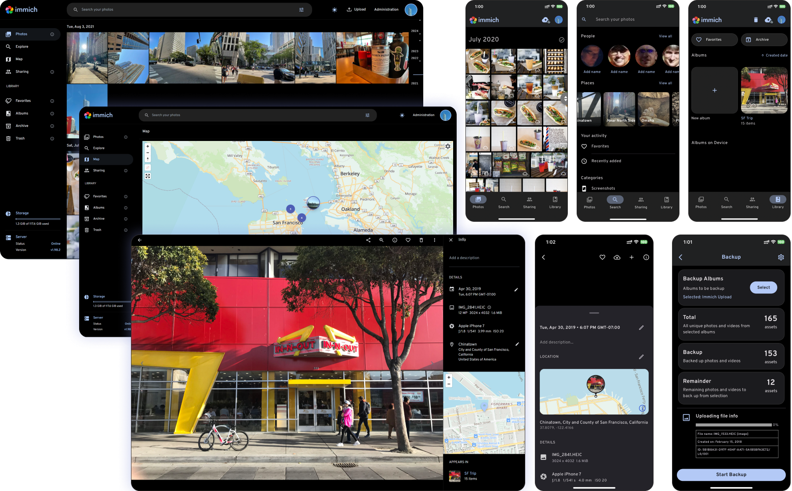

 
   
  
  
   
   

  

<h3 align="center">High performance self-hosted photo and video management solution</h3>
 

 

  <a href="readme_i18n/README_ca_ES.md">Català</a>
  <a href="readme_i18n/README_es_ES.md">Español</a>
  <a href="readme_i18n/README_fr_FR.md">Français</a>
  <a href="readme_i18n/README_it_IT.md">Italiano</a>
  <a href="readme_i18n/README_ja_JP.md">日本語</a>
  <a href="readme_i18n/README_ko_KR.md">한국어</a>
  <a href="readme_i18n/README_de_DE.md">Deutsch</a>
  <a href="readme_i18n/README_nl_NL.md">Nederlands</a>
  <a href="readme_i18n/README_tr_TR.md">Türkçe</a>
  <a href="readme_i18n/README_zh_CN.md">简体中文</a>
  <a href="readme_i18n/README_zh_TW.md">正體中文</a>
  <a href="readme_i18n/README_uk_UA.md">Українська</a>
  <a href="readme_i18n/README_ru_RU.md">Русский</a>
  <a href="readme_i18n/README_bg_BG.md">Български</a>
  <a href="readme_i18n/README_pl_PL.md">Polski</a>
  <a href="readme_i18n/README_pt_BR.md">Português Brasileiro</a>
  <a href="readme_i18n/README_sv_SE.md">Svenska</a>
  <a href="readme_i18n/README_ar_JO.md">العربية</a>
  <a href="readme_i18n/README_vi_VN.md">Tiếng Việt</a>
  <a href="readme_i18n/README_th_TH.md">ภาษาไทย</a>
  <a href="readme_i18n/README_ml_IN.md">മലയാളം</a>

## About this fork

This repository is a fork of [immich-app/immich](https://github.com/immich-app/immich) that adds one
extra feature on top of upstream: a small floating **map overlay** in the web Asset Viewer.

- When you open a photo that has GPS coordinates, a draggable mini-map appears over the photo
  (bottom right by default), with a pin at the exact location.
- It can be dragged by its header, closed to a small map icon, and reopened again; the visibility
  and position are remembered per browser (`localStorage`).
- It automatically hides while the detail panel or editor is open, and it does not appear at all for
  assets without GPS data.
- It works in the normal signed-in viewer, in albums, and on public/password-protected **shared
  album links** — it reuses the asset data and map component the viewer already has, so it makes no
  extra API calls and needs no additional authorization.

**Changed/added files** (see [`AssetMapOverlay.svelte`](web/src/lib/components/asset-viewer/AssetMapOverlay.svelte)):

- `web/src/lib/components/asset-viewer/AssetMapOverlay.svelte` — new overlay component
- `web/src/lib/stores/asset-map-overlay.store.ts` — new persisted store (visibility + position)
- `web/src/lib/components/asset-viewer/AssetViewer.svelte` — minimal integration (one import, one
  render block)

Everything else in this repository tracks upstream `immich-app/immich` `main` unmodified.

> [!WARNING]
> ⚠️ Always follow [3-2-1](https://www.backblaze.com/blog/the-3-2-1-backup-strategy/) backup plan for your precious photos and videos!
> 
 

> [!NOTE]
> You can find the main documentation, including installation guides, at https://immich.app/.

## Links

- [Documentation](https://docs.immich.app/)
- [About](https://docs.immich.app/overview/introduction)
- [Installation](https://docs.immich.app/install/requirements)
- [Roadmap](https://immich.app/roadmap)
- [Demo](#demo)
- [Features](#features)
- [Translations](https://docs.immich.app/developer/translations)
- [Contributing](https://docs.immich.app/overview/support-the-project)

## Demo

Access the demo [here](https://demo.immich.app). For the mobile app, you can use `https://demo.immich.app` for the `Server Endpoint URL`.

### Login credentials

| Email           | Password |
| --------------- | -------- |
| demo@immich.app | demo     |

## Features

| Features                                     | Mobile | Web |
| :------------------------------------------- | ------ | --- |
| Upload and view videos and photos            | Yes    | Yes |
| Auto backup when the app is opened           | Yes    | N/A |
| Prevent duplication of assets                | Yes    | Yes |
| Selective album(s) for backup                | Yes    | N/A |
| Download photos and videos to local device   | Yes    | Yes |
| Multi-user support                           | Yes    | Yes |
| Album and Shared albums                      | Yes    | Yes |
| Scrubbable/draggable scrollbar               | Yes    | Yes |
| Support raw formats                          | Yes    | Yes |
| Metadata view (EXIF, map)                    | Yes    | Yes |
| Search by metadata, objects, faces, and CLIP | Yes    | Yes |
| Administrative functions (user management)   | No     | Yes |
| Background backup                            | Yes    | N/A |
| Virtual scroll                               | Yes    | Yes |
| OAuth support                                | Yes    | Yes |
| API Keys                                     | N/A    | Yes |
| LivePhoto/MotionPhoto backup and playback    | Yes    | Yes |
| Support 360 degree image display             | No     | Yes |
| User-defined storage structure               | Yes    | Yes |
| Public Sharing                               | Yes    | Yes |
| Archive and Favorites                        | Yes    | Yes |
| Global Map                                   | Yes    | Yes |
| Partner Sharing                              | Yes    | Yes |
| Facial recognition and clustering            | Yes    | Yes |
| Memories (x years ago)                       | Yes    | Yes |
| Offline support                              | Yes    | No  |
| Read-only gallery                            | Yes    | Yes |
| Stacked Photos                               | Yes    | Yes |
| Tags                                         | No     | Yes |
| Folder View                                  | Yes    | Yes |

## Translations

Read more about translations [here](https://docs.immich.app/developer/translations).

## Repository activity

## Contributors

